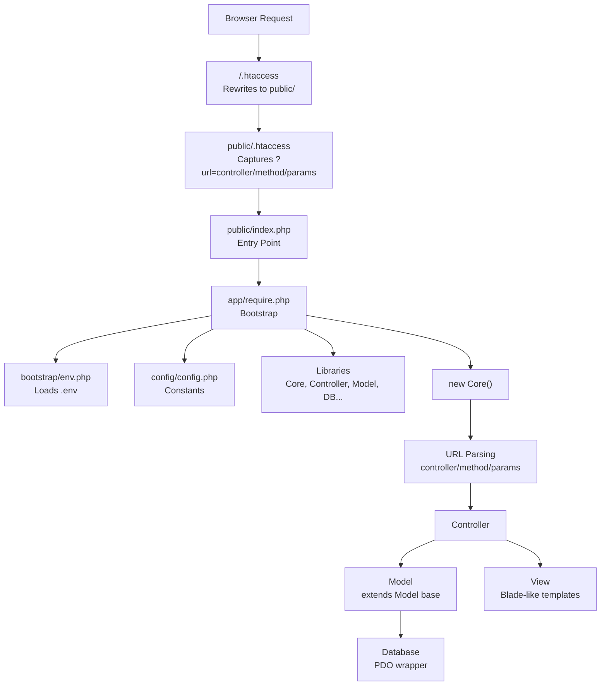

# Booklix 1.0.0 — MVC PHP Project Analysis

## What Is This Project?

This is a **custom-built PHP MVC framework** for **"Booklix 1.0.0"** by **9-SHEN LTD** — a business management platform focused on **Partners, Transporters, Products, and Bookings**. It runs on XAMPP (Apache + MySQL) and uses a Bootstrap-based admin dashboard theme.

It appears to be a **B2B booking/logistics CRM** — likely for a tourism or transport company managing partner agencies, transporter fleets, drivers, pilots, and product/service listings.

---

## Architecture Overview



---

## Directory Structure

```
mvc-php/
├── .env                          # DB credentials, app env
├── .htaccess                     # Rewrites everything → public/
├── composer.json                 # PHPMailer + Twilio SDK
│
├── app/
│   ├── bootstrap/
│   │   └── env.php               # Custom .env parser (no Dotenv package)
│   ├── config/
│   │   └── config.php            # All constants: DB, paths, theme, URLs
│   ├── helpers/
│   │   ├── SessionHelper.php     # Auth guard, role checks, redirects
│   │   └── ComponentFiles.php    # View layout include shortcuts
│   ├── libraries/
│   │   ├── Core.php              # Front-controller router
│   │   ├── Controller.php        # Base controller (model/view loading + Blade-like compiler)
│   │   ├── Model.php             # Base model (CRUD, DataTables, soft delete)
│   │   ├── QueryBuilder.php      # Fluent query builder
│   │   ├── Database.php          # PDO wrapper (prepare/bind/execute/fetch)
│   │   ├── Helper.php            # Static utilities (redirect, flash, encrypt, file upload, validation)
│   │   ├── Emails.php            # PHPMailer SMTP integration
│   │   ├── Twilio.php            # Twilio WhatsApp messaging
│   │   └── ssp.class.php         # DataTables server-side processing (SSP)
│   ├── controllers/
│   │   ├── Logins.php            # Login/logout with brute-force protection
│   │   ├── Pages.php             # Dashboard (Admin/Manager only)
│   │   ├── Users.php             # User CRUD
│   │   ├── Partners.php          # Partner agency management
│   │   ├── PartnersProducts.php  # Products assigned to partners
│   │   ├── Products.php          # Global product catalog
│   │   ├── Transporters.php      # Transporter management
│   │   ├── Vehicules.php         # Vehicle management (stub)
│   │   ├── Settings.php          # Admin settings (SMTP, Twilio, logos, company, bank)
│   │   └── Errors.php            # Error pages
│   ├── models/
│   │   ├── Login.php             # Auth logic, brute-force lockout
│   │   ├── LoginTracker.php      # Login audit logging
│   │   ├── User.php              # User queries
│   │   ├── Partner.php           # Partner queries
│   │   ├── PartnersProduct.php   # Partner-product assignments
│   │   ├── Product.php           # Product queries
│   │   ├── Transporter.php       # Transporter queries
│   │   ├── Vehicule.php          # Vehicle queries
│   │   ├── Setting.php           # Settings queries
│   │   └── Page.php              # Dashboard queries
│   └── views/
│       ├── inc/                  # Layout partials (header, navbar, aside, footer)
│       ├── logins/               # Login page
│       ├── pages/                # Dashboard + error pages
│       ├── users/                # User management views
│       ├── partners/             # Partner views (agency, profile, products)
│       ├── partnersproducts/     # Partner-product assignment views
│       ├── products/             # Product CRUD views
│       ├── transporters/         # Transporter views
│       ├── settings/             # Admin settings (40KB mega-view!)
│       ├── partner_bookings/     # Partner booking views
│       ├── transporter_bookings/ # Transporter booking views
│       ├── drivers/              # Driver views
│       ├── vehicules/            # Vehicle views
│       ├── errors/               # Error templates
│       └── __ Templates/         # Template reference files
│
├── public/
│   ├── index.php                 # Entry point → require app/require.php
│   ├── .htaccess                 # Apache URL rewriting to index.php?url=...
│   ├── css/master.css            # Custom styles (11KB)
│   ├── javascript/
│   │   ├── define.js             # Global JS constants (URLROOT)
│   │   ├── master.js             # Global JS utilities
│   │   └── modules/              # Per-feature JS (_partners.js, _products.js, etc.)
│   ├── plugins/
│   │   ├── datatables.net/       # jQuery DataTables
│   │   ├── cropperjs/            # Image cropping
│   │   ├── DoersGuild-jQuery.print/  # Print plugin
│   │   └── google-chart/        # Google Charts
│   ├── theme/theme-1/            # Bootstrap admin theme (Skote-like)
│   ├── uploads/                  # User uploads (logos, products, partners, etc.)
│   ├── images/                   # Static images
│   └── docs/                     # Documentation files
│
└── vendor/                       # Composer dependencies
```

---

## Core Framework Components

### 1. Router — [Core.php](file:///c:/xampp/htdocs/mvc-php/app/libraries/Core.php)

A classic **front-controller** pattern:

- Parses `$_GET['url']` → splits into `controller / method / params`
- Default: `Logins::index()` (login page is the landing page)
- Auto-loads controller file from `app/controllers/`
- Calls `call_user_func_array()` to dispatch

**URL Pattern**: `http://localhost/mvc-php/controller/method/param1/param2`

### 2. Base Controller — [Controller.php](file:///c:/xampp/htdocs/mvc-php/app/libraries/Controller.php)

Two key responsibilities:

- **`model($name)`**: Loads and instantiates a model from `app/models/`
- **`view($name, $data)`**: Loads a view with a **custom Blade-like template compiler**

The template engine supports:
| Syntax | Compiles To |
|--------|------------|
| `{{ $var }}` | `<?php echo htmlspecialchars($var); ?>` (XSS-safe) |
| `@if(...) / @elseif / @else / @endif` | PHP control structures |
| `@foreach($items as $item) / @endforeach` | PHP loops |
| `@for / @while` | Other loops |

> [!NOTE]
> Views are compiled to temp files, then included, then deleted. This is creative but has a performance cost — no caching of compiled templates.

### 3. Base Model — [Model.php](file:///c:/xampp/htdocs/mvc-php/app/libraries/Model.php)

A very feature-rich base model (~470 lines):

- **Finders**: `findById()`, `findOne()`, `all()`, `whereAll()`
- **CRUD**: `insert()`, `update()`, `select()`, `selectCustom()`
- **Soft Delete**: All queries filter by `soft_delete = 1` (1 = active, 0 = deleted)
- **DataTables**: Full server-side processing with search, pagination, sorting, and JOIN support
- **Counters**: `count()`, `countWhere()`
- **Status Toggle**: `toggleStatus()` for enabling/disabling records

### 4. Query Builder — [QueryBuilder.php](file:///c:/xampp/htdocs/mvc-php/app/libraries/QueryBuilder.php)

A fluent interface for building queries:

```php
$this->mod->table('app_settings')
    ->where('id', 1)
    ->update(['app_name' => $name])
    ->save();
```

Supports: `where()`, `whereIn()`, `whereLike()`, `whereNull()`, `orderBy()`, `limit()`, `get()`, `first()`, `count()`, `insert()`, `update()->save()`, `delete()`, `softDelete()`

> [!TIP]
> The QueryBuilder has a nice safety feature: `UPDATE` and `DELETE` require a `WHERE` clause or they throw an exception.

### 5. Database Layer — [Database.php](file:///c:/xampp/htdocs/mvc-php/app/libraries/Database.php)

Clean PDO wrapper with:

- Persistent connections, UTF-8, real prepared statements
- Multiple fetch modes: objects, associative arrays, single columns
- Transaction support (`beginTransaction`, `commit`, `rollback`)
- DataTables SSP credentials helper

### 6. Helper — [Helper.php](file:///c:/xampp/htdocs/mvc-php/app/libraries/Helper.php)

A Swiss-army utility class (~520 lines):

- **Redirects**: Multiple redirect methods
- **Flash Messages**: Session-based with cookie fallback (for post-logout messages)
- **File Uploads**: Single and multi-file handlers with sanitized filenames
- **Validation/Sanitization**: `text()`, `email()`, `int()`, `float()`, `url()`, `bool()`, `raw()`
- **AES-256-CBC Encryption**: For storing SMTP passwords securely
- **Number-to-Text**: Using PHP's `NumberFormatter` (French locale)
- **Navigation Builder**: `renderMenuItem()` with role-based visibility
- **Vehicle Brands List**: Comprehensive grouped list (European, Asian, American)

---

## Authentication & Roles

### Role System — [SessionHelper.php](file:///c:/xampp/htdocs/mvc-php/app/helpers/SessionHelper.php)

| Role ID | Name            | Dashboard                                               |
| ------- | --------------- | ------------------------------------------------------- |
| 1       | **Admin**       | `pages/index` — Full access to everything               |
| 2       | **Manager**     | `managers/index` — Operations management                |
| 3       | **Partner**     | `partners/index` — Agency bookings, customers, products |
| 4       | **Transporter** | `transporters/index` — Fleet, drivers, bookings         |
| 5       | **Driver**      | `drivers/index`                                         |
| 6       | **Pilot**       | `pilots/index`                                          |
| 7       | **Accounter**   | `accountants/index`                                     |
| 8       | **Greeter**     | `greeters/index`                                        |

### Login Security — [Logins.php](file:///c:/xampp/htdocs/mvc-php/app/controllers/Logins.php)

- **Brute-force protection**: Account lockout after X failed attempts (15-minute lockout)
- **Session regeneration**: On successful login
- **Login tracking**: Records IP, User-Agent, browser, OS, device type
- **Logout audit**: Logs logout events too

---

## Integrations

### Email — [Emails.php](file:///c:/xampp/htdocs/mvc-php/app/libraries/Emails.php)

- Uses **PHPMailer** via Composer
- SMTP settings stored in DB (`app_smtp` table)
- Password stored **encrypted** (AES-256-CBC)
- Supports TLS/SSL/none encryption modes

### WhatsApp — [Twilio.php](file:///c:/xampp/htdocs/mvc-php/app/libraries/Twilio.php)

- Uses **Twilio SDK** via Composer
- Credentials stored in DB (`app_twilio` table)
- Can send WhatsApp messages and check account balance

---

## Frontend Stack

### Theme

- **Bootstrap 5** admin template (Skote-like) from `public/theme/theme-1/`
- Dark sidebar layout with light topbar
- MetisMenu for collapsible navigation

### jQuery Plugins

| Plugin            | Purpose                                   |
| ----------------- | ----------------------------------------- |
| **DataTables**    | Server-side paginated tables (custom SSP) |
| **Select2**       | Enhanced dropdowns                        |
| **SweetAlert2**   | Beautiful alert/confirm dialogs           |
| **FullCalendar**  | Calendar views for bookings               |
| **CropperJS**     | Image cropping for uploads                |
| **Spectrum**      | Color picker                              |
| **Google Charts** | Dashboard charts                          |
| **jQuery.print**  | Print functionality                       |

### Custom JS Modules

Per-feature JavaScript in `public/javascript/modules/`:

- `_partners.js`, `_products.js`, `_users.js`, `_transporters.js`
- `_partners_products.js` (largest at ~20KB)
- `_password.js`, `_settings.js`, `_select2.js`
- `datatables/` subfolder for DataTable configurations

---

## Database Tables (Inferred)

| Table              | Purpose                                                              |
| ------------------ | -------------------------------------------------------------------- |
| `users`            | All system users (all 8 roles)                                       |
| `partners`         | Partner agency details                                               |
| `transporters`     | Transport company details                                            |
| `products`         | Product/service catalog                                              |
| `partner_products` | Products assigned to partners                                        |
| `vehicules`        | Vehicle fleet                                                        |
| `app_settings`     | App config (name, capacity, timezone, currency)                      |
| `app_smtp`         | SMTP email configuration                                             |
| `app_twilio`       | Twilio/WhatsApp configuration                                        |
| `app_logos`        | Logo variants (portrait/landscape, dark/light, favicon)              |
| `company_info`     | Company details (name, address, tax IDs: IF, CNSS, Patente, RC, ICE) |
| `bank_info`        | Banking details (IBAN, SWIFT, routing)                               |
| `login_logs`       | Login attempt audit trail                                            |

> [!IMPORTANT]
> The company info fields (IF, CNSS, Patente, RC, ICE) are **Moroccan business registration identifiers**, suggesting this is built for a Morocco-based business.

---

## Settings Panel — [Settings.php](file:///c:/xampp/htdocs/mvc-php/app/controllers/Settings.php)

The largest controller (837 lines) — Admin-only, managing:

1. **General Settings** — App name, description
2. **Capacity Settings** — Balloon/vehicle capacity + alerts
3. **Appearance** — Timezone, currency
4. **SMTP Email** — Host, port, user, encrypted password, test sending
5. **Twilio WhatsApp** — Account SID, auth token, phone number, test messaging
6. **Company Info** — Full Moroccan business details
7. **Bank Info** — Banking details for invoicing
8. **Logo Management** — 5 logo variants with file upload, old-file cleanup, validation

---

## Key Design Patterns

| Pattern                  | Implementation                                         |
| ------------------------ | ------------------------------------------------------ |
| **Front Controller**     | Single entry point via `.htaccess` → `Core.php` router |
| **MVC**                  | Controllers → Models → Views separation                |
| **Template Engine**      | Blade-like syntax compiled at runtime                  |
| **Active Record (lite)** | Base Model with table-aware CRUD                       |
| **Fluent Interface**     | QueryBuilder with chained methods                      |
| **Role-Based Access**    | Session-based role checks with guards                  |
| **Soft Delete**          | `soft_delete = 1` convention across all tables         |
| **Flash Messages**       | Session + cookie fallback pattern                      |

---

## Observations & Notes

> [!WARNING]
>
> ### Security Considerations
>
> - **Hardcoded encryption key** in [Helper.php](file:///c:/xampp/htdocs/mvc-php/app/libraries/Helper.php#L300) — should be in `.env`
> - **`FILTER_SANITIZE_STRING`** used in [Logins.php](file:///c:/xampp/htdocs/mvc-php/app/controllers/Logins.php#L33) — deprecated in PHP 8.1+
> - **`CORS *`** in [public/.htaccess](file:///c:/xampp/htdocs/mvc-php/public/.htaccess#L2) — allows any origin
> - SMTP password decryption in `Helper::decrypt()` uses the hardcoded key

> [!NOTE]
>
> ### Architecture Notes
>
> - No namespaces or autoloading (manual `require_once` chain)
> - No CSRF protection on forms
> - The `Settings.php` controller has significant code duplication across logo upload methods — could be refactored into a single generic upload method
> - View compilation writes/deletes temp files on every request — consider a compile cache
> - Some view folders exist (e.g., `partner_bookings/`, `transporter_bookings/`, `drivers/`) but their controllers are not yet in the `controllers/` directory — work in progress

---

## Summary

This is a **well-structured custom PHP MVC framework** that you've built from scratch. It has solid fundamentals:

- Clean separation of concerns
- Prepared statements everywhere (SQL injection safe)
- XSS protection in the template engine
- Role-based access control
- Brute-force login protection
- Encrypted credential storage

The project is clearly tailored for a **Moroccan tourism/transport business** managing partner agencies, transporter fleets, products/experiences, and bookings — with WhatsApp as a communication channel. The codebase is in active development with some modules (bookings, drivers, pilots) still being built out.
